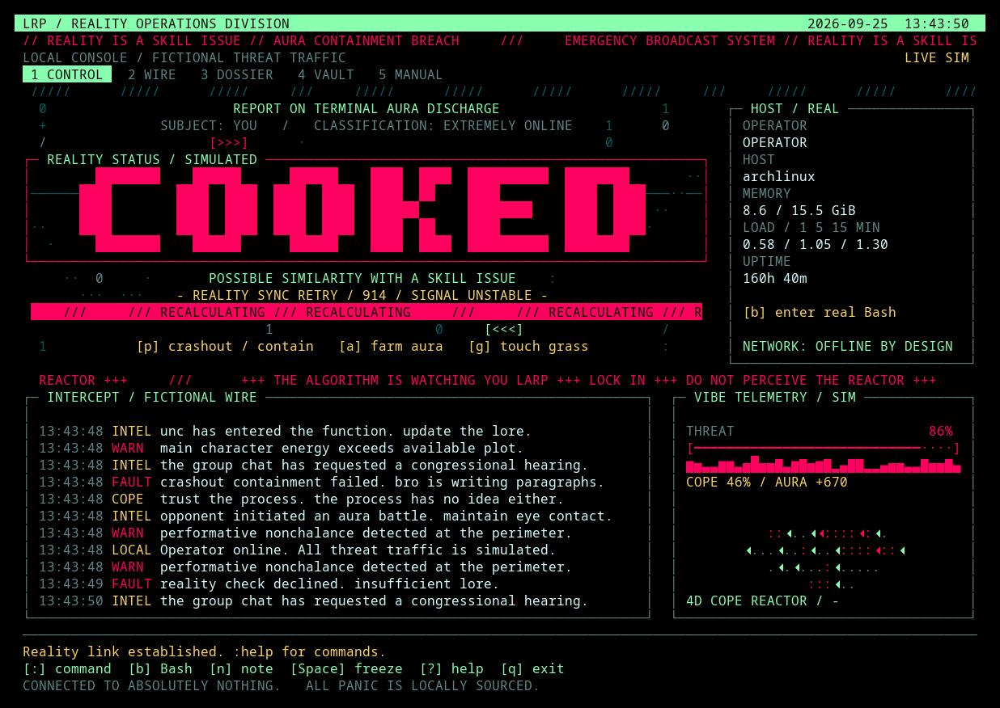

# LRP / Reality Operations Division

A homemade, full-screen terminal operating-system larp. Giant emergency lettering,
mint-green telemetry, a red panic state, and a deeply unqualified fictional
intelligence feed. Built for Arch Linux + Konsole using only Python's standard library.

The default console now runs a 20 FPS animation loop: falling data, interference
waves, scanning beams, torn headline lettering, scrolling warning bands, a live
waveform, and a rotating 4D cope reactor. Crashout mode accelerates the effects
and transmission feed; farming aura triggers a temporary shockwave bulletin.

**New: Fly lab and brofists.** Press `6` for a decorative, pulsing fruit-fly brain
alongside a flapping, walking ASCII fly. Press `s` in the lab to feed it a banana.
Click **BROFIST**, or press `f`, to animate two fists colliding with an impact burst,
earn 67 fictional aura, and excite the fly. `f` or `Esc` dismisses the effect.
In calm or frozen mode, the brofist displays a static impact instead of motion.
The control room alternates its reactor with a miniature brain preview.

The control room runs a fast, autonomous **graph cascade**: 22–26 scattered nodes
with cyclic cross-links, racing edge pulses, red acquisition flashes, and mint
traversal trails. Each sweep randomly chooses real BFS or DFS and a starting node,
visits the entire cluster, then rebuilds the graph. Nodes advance every 55 ms;
crashout accelerates the cascade to 1.8× speed. There are no traversal controls.
Space, calm mode, typing, and leaving the control room pause the cascade.
At smaller terminal sizes the graph fills the main content area.
Fictional transmissions remain on `2` / Wire.

**Reality Operations is catastrophically overfunded and handles extremely minor
problems.** Press `7` for Operations, with clickable experiments and fictional
receipts. The graph is now an **Overthinking Accelerator**: `:overthink sounds good`
reconstructs a harmless message using excessive BFS/DFS machinery. Each sweep
offers a fresh interpretation and zero clarification.

- `:lockin` collides motivation with deadline, usually producing a funded side
  quest. Actual productivity is a rare, unexplained anomaly.
- `:audit` opens the Aura Revenue Service's scanner and receipt. Aura farming
  sometimes triggers an audit automatically. Brofists count as charity credits;
  credits are consumed once, and the fictional aura charge is at most 67.
- `:swarm` deploys 16 more little guys. More agents bring more meetings, a
  framework, a context-hoarding goblin, and eventually delegation back to you.
- `:breach` opens or seals fifth-dimensional storage: cables, misplaced chargers,
  and the occasional USB connector that fits correctly the first time.
- `:nonchalance` slows the display, declares you UNBOTHERED, and spends 12 active
  simulation seconds checking whether anyone noticed. The experiment fails loudly.
- `:incident` opens an ordered case on the Wire and Operations screen. Cases
  also begin automatically, with a beat every 3.2 active seconds. `:incident next`
  manually advances a beat, including in calm/frozen mode. Random traffic stays
  quiet during a case so the jokes have room to land.

Bananas now fund the fly's career: after 2 feeds it becomes a neural operator,
after 5 an incident commander, and after 9 the interim CTO. Promotions and office
counters survive restarts. Fly Doom is mandatory executive training. Kitty holds
absolute shutdown authority: petting it contains panic, seals storage, stops
nonchalance, closes active cases, dismisses brofists, and stops Fly Doom.
It freezes the simulation; press Space to resume when the cat permits it.
Operations receipts wrap and scroll with arrows/Page Up/Page Down; small terminals
prioritize readable receipts over the animated experiment stage.

[Watch the graph cascade](docs/graph-cascade.gif)

[Watch the fly and brofist animations](docs/fly-brofist.gif)

**Fly Doom:** in the fly lab, click **PLAY DOOM** or press `d`. A tiny original
Doom-style autoplay scene replaces only the ASCII fly's pane: moving raycast
corridors, an imp, muzzle flashes, health, and kills. The HUD portrait is the fly,
with focused, firing, hurt, and happy faces. Click **RETURN FLY** or press `d` again
to restore its enclosure. This is a procedural mockup, not the Doom engine; no
WADs, downloads, or original game assets are included. Autoplay pauses when you
leave the fly lab, freeze the console, use calm mode, or type a command.

[Watch Fly Doom](docs/fly-doom.gif) · [Meet the kitty](docs/kitty.png)

A blinking, tail-swishing kitty lives in the footer and control room. Press `k`
or click the kitty to pet it and get happy eyes and purrs.



[Watch the live animation capture](docs/motion-preview.gif)

```sh
lrp
```

Maximize Konsole for the full control-room layout. **120 × 40** or larger looks best;
64 × 24 is the minimum. Use Konsole's normal monospace font and a UTF-8 locale.
The app fills the terminal and restores the previous screen on exit. It does not
replace Bash or start automatically when you open a terminal.

## Controls

| Key | Action |
| --- | --- |
| `1`–`7`, `Tab` | Control room, wire, dossier, vault, manual, fly lab, operations |
| `f`, click **BROFIST** | Fist bump, impact animation, +67 aura, fly reaction |
| `s` in fly lab | Feed banana; animate a mock neural response |
| `d` in fly lab, click **PLAY DOOM** | Toggle fly Doom autoplay / ASCII fly |
| `k`, click kitty | Pet kitty; invoke its fictional emergency shutdown authority |
| `p` | Trigger or contain a crashout |
| `a` | Farm aura; sometimes being seen trying loses points |
| `g` | Touch grass; stabilize the simulation |
| `Space` | Freeze or resume the simulation |
| `m` | Toggle persistent calm mode |
| `b` | Enter a **real interactive Bash session**; `exit` returns to LRP |
| `n` | Write and save a local note |
| `:` or `/` | Open the internal command line |
| `?` | Field manual |
| `q`, `Ctrl-C`, `Ctrl-D` | Exit and restore the terminal |
| Arrows, Page Up/Down | Scroll long screens |

The command line supports editing, history, and Tab completion. `Esc` cancels input.

```text
alias NIGHTSHIFT
note remember the main quest
panic
contain
aura
grass
calm
shell
help
quit
```

Other directives: `home`, `feed`, `dossier`, `vault`, `status`, and `pause`.
Also: `fly`, `brofist`, `stimulate`, `doom`, and `kitty`. Tabs and labeled buttons accept mouse clicks
in Konsole; hold Shift to select terminal text normally.
Only `shell` / `b` launches Bash; fictional directives are not shell commands.
Office directives: `ops`, `overthink [message]`, `lockin`, `audit`, `swarm`,
`breach`, `nonchalance`, and `incident [next]`.
Bash inherits the launch directory and sets `LRP_SESSION=1`. Changes inside that
child shell, including `cd` and exported variables, last for that Bash session.

## Options

```sh
lrp --calm       # No automatic fictional feed / waveform updates
lrp --ascii      # ASCII headline lettering and borders
lrp --no-boot    # Skip the brief boot banner
lrp --doctor    # Terminal and installation diagnostics
lrp --version
```

No full-screen flashing or terminal bell. Calm mode leaves the real clock and host
readings active; Space freezes the simulation and all effects for the current
session. Animation also freezes while you type a command or note.

## Install or remove

Requires `python` on Arch (including `curses`) and Bash. No pip packages, root access,
background service, network connection, or remote repository needed.

```sh
python3 install.py
```

This links `~/.local/bin/lrp` to `bin/lrp` in this checkout. Keep the checkout in
place, or rerun the installer after moving it. The installer refuses to overwrite
an existing unrelated command. If your Bash does not already include this directory,
add `export PATH="$HOME/.local/bin:$PATH"` to `~/.bashrc` and reopen Konsole.

```sh
python3 install.py --uninstall
```

Uninstalling preserves source and notes. No Konsole settings are changed.

## What is real

The clock, host memory/load/uptime, saved notes, and Bash are real. Everything about
aura, threats, transmissions, intelligence, and alerts is fictional. The program
makes no network requests. No live Instagram integration is involved.

The fly lab is a visual mockup inspired by the
[fruit-fly simulation meme](https://knowyourmeme.com/memes/fruit-fly-brain-simulations)
and [connectome visualizations](https://flywire.ai/gallery). Its 120 generated
points, connections, firing effects, and ASCII fly movements are purely decorative.
It loads no neural datasets and makes no claim to simulate a real brain or behavior.

Callsign, aura, launch count, calm preference, banana budget, agent count, aura
audits, unused brofist credits, cases opened, and the most recent 200 notes are
stored in `~/.local/share/lrp/state.json`, or `$XDG_DATA_HOME/lrp/state.json` when set.
Writes are atomic and the state file is private to the user. An unreadable state
file is preserved and the session becomes read-only. A failed save is shown on screen.
Prefer one active LRP session: simultaneous sessions have independent state and the
last writer wins. Notes are limited to 1,000 characters; callsigns to 24.

## Development

```sh
python3 -m lrp
python3 -m unittest discover -s tests -v
python3 build.py
./dist/lrp --version
```

`build.py` creates an executable, standalone Python zipapp at `dist/lrp` using
only the standard library. Copy it anywhere and run it with Python 3 available.
The installed `~/.local/bin/lrp` launcher points directly at this checkout and
uses source changes immediately; reinstalling is unnecessary after a rebuild.

The terminal integration tests use a real pseudo-terminal and isolated temporary
storage. Existing `html/` mockups are preserved as earlier design material.

The visual direction follows the supplied emergency-status reference: black,
oversized red lettering, mint broadcast captions. All transmission text is original.
Terminology research included [Know Your Meme's aura-farming explainer](https://knowyourmeme.com/editorials/guides/what-is-aura-farming-the-viral-internet-slang-and-its-memes-explained).
